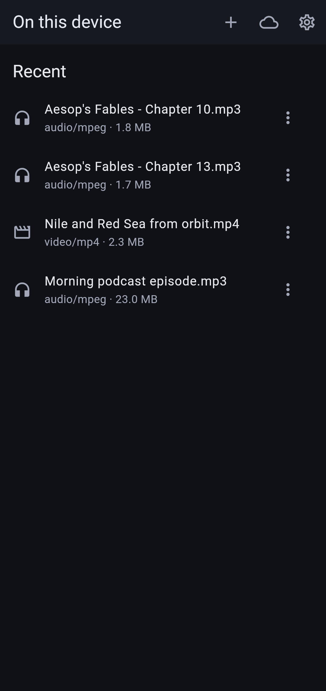
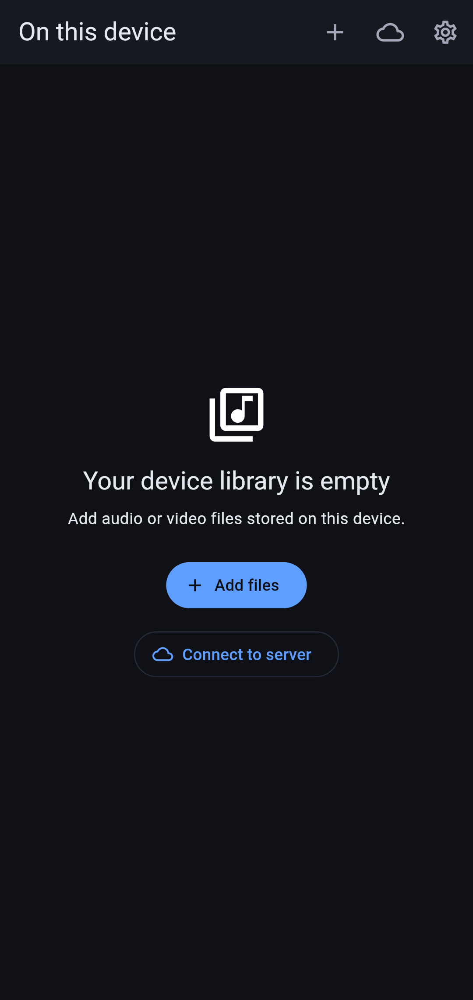
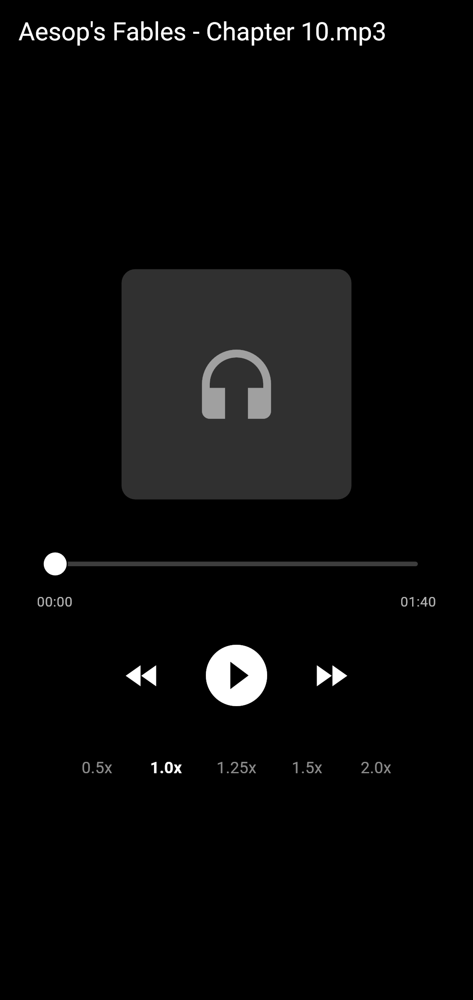

# Player Android

Android audio/video player for device files and the Player server.

The installed app version and build number appear at the bottom of **Settings**.

## Music visualizations

The audio player offers **Music visuals**: Spectrum, Waveform, Radial, Mirror,
Orbit, and Off. They react to the playing track for server streams, public
shares, device files and offline downloads. The selected mode is saved. Off
shows cover artwork; new installs start Off, and reduced-motion users start
Off when opening a player. Audiobook names and `.m4b` files suppress visuals.

Selecting a visualization requests Android's audio permission. Android requires
this permission to read the player's waveform and spectrum; Player never opens
the microphone or captures other apps' audio. Declining permission or an
unsupported device leaves playback and cover art available. Sampling stops
when playback pauses, the player is covered, or the app goes into the background.

Verify the feature with `flutter test test/widgets/audio_visuals_test.dart` and
the native emulator test. Run
`flutter test integration_test/audio_visuals_test.dart -d emulator-5554`.
When it reports that it is waiting for permission, run
`adb shell pm grant zone.foo.player_android android.permission.RECORD_AUDIO`
in another terminal (the test runner can clear grants when reinstalling).
The native test generates its own music and checks nonzero waveform/spectrum
data for all five modes, Off, pause/resume and replacing the track.

## Screenshots

| On this device | Empty library | Audio player |
| --- | --- | --- |
|  |  |  |

## Play files on this device

A fresh install opens **On this device**. No server, account, or network
connection is needed. Tap **Add files**, choose audio or video, then select a
file in Android's document picker. Tap its library entry to play it again.

Player retains permission to read the selected document and stores its resume
position locally. It does not copy the file. Audio keeps playing after Back or
Home, with Android notification and lock-screen controls. Video saves progress
when leaving the player or putting the app in the background. Replaying a
finished item starts from the beginning. Force-stopping the app can lose
progress since the last save.

Use an entry's menu for **Choose file again** or **Remove from library**.
Removal stops that item if it is playing and removes its local history and
retained permission; the original file stays on your device. If a file moves,
becomes unreadable, or cannot be decoded, the player may show **Retry**. Return
to the library to choose a replacement or remove the entry.

Formats depend on Android's decoders. MP3 audio and H.264/AAC MP4 video were
verified with the normal app on Android 14/API 34 using the Downloads provider.
Physical devices, other document providers, and removable storage have not
been verified. See the [verification results](docs/standalone-playback-verification.md)
for the exact platform checks and automated coverage.

Folder scanning, playlists, local tags, and syncing local
history across devices are outside this feature.

## Keep server files offline

Open a server file's details and tap **Keep offline**. Audio, video and images
are saved in Player's private storage. For formats Android cannot play directly,
Player downloads the server's converted playback copy. Keep the app open while
downloading; the action shows the byte count and lets you cancel. A failed or
cancelled download is never listed as ready. Downloading uses available device
storage without imposing a fixed movie-size limit.

Open **Downloads** from the server navigation menu or the download icon in
**On this device**. Downloads work after an app restart, without a server
connection or login. Saved copies are identified by server origin, account and
media ID, so matching IDs on another server or account stay separate. All copies
kept on this device remain accessible in Downloads, including after logout.
Resume positions and position bookmarks sync with the same account on that
server, including streaming playback and other Android devices. Offline edits
are saved durably and retried after you sign in to their original server and
account. The newest edit timestamp wins; reconnect time does not change it.
Bookmark deletions also sync. Keep device clocks accurate for consistent ordering.
Sync pauses while the account is locked or signed out. Older download resume
positions without edit timestamps stay local until the next playback save,
unless server state is already available; existing bookmarks retain their
original creation timestamps during migration. Offline images include SVGs
supported by the same safety limits as server images. Public share links cannot
be kept offline from the app.

Use **Delete offline copy** in Downloads to stop that file's playback and remove
its downloaded bytes, local notes and favorites. Synced progress, bookmarks
and pending edits remain associated with their original server and account.
The remote media and files you added through Android's document picker stay
available. Uninstalling Player or clearing
its app storage removes downloads. An interrupted download is discarded when
Downloads next opens; it can be downloaded again from the server file's details.

See [offline verification](docs/offline-downloads-verification.md) for automated
coverage and the repeatable Android device test.

## Bookmarks, notes and favorites

In audio or video playback, tap **Bookmarks**, optionally enter a label, then
**Save current position**. The list shows each timestamp and label. Tap a saved
position to jump there, or its **Delete bookmark** button to remove it. Saved
positions are separate from automatic resume progress.

Tap **Notes** in playback to edit your personal note. Notes also appear in a
device file's menu and beside each download. Edits save automatically; Back
waits for the latest edit to save. A failed save keeps the draft open for retry.
Images use **Add to favorites** to save the whole item and also have notes.
Public shares do not expose account notes, bookmarks or favorites.

Server notes, bookmarks and favorites belong to the signed-in account and
are stored on that server. Position bookmarks require a server version that
provides the bookmarks API. Downloaded progress and bookmarks require the
playback-sync API; an older server leaves edits queued locally until upgraded.
Device files keep all personal data on this device. Downloads keep notes and
favorites local, while their progress and bookmarks sync when the matching
account is signed in. Everything remains available offline. Copies from
different servers or accounts stay separate. Choosing a device file again
preserves its notes and bookmarks, even when starting its resume progress over.
Removing a device entry removes its personal data. Deleting an offline copy preserves its
server progress and bookmarks.

## Connect to a server

Tap **Connect to server**, select a saved server or enter another server origin
and save it. The app keeps a separate saved login for each HTTP/HTTPS origin
(including its port). Once a server is saved, every app start asks you to select
a server or **Use files on this device**. A fresh install still opens the local
library directly.

This also applies after force-stop or a device cold boot: the server and its
saved login remain remembered, but selecting the server does not unlock it.
Browser sessions follow the browser's separate cookie policy.

Create the first admin account if the server is new, or sign in to an existing
account. To reuse a saved login, tap **Unlock saved login with fingerprint** and
complete the device's biometric prompt, or enter your server account password
for a fresh sign-in. Device PIN/password fallback is disabled: the password
option is your server password. Cancelling or failing biometrics leaves the
login locked; password sign-in also works without biometric hardware. The local
library remains available without a network connection. Saved bearer tokens live
in Android's secure storage; account passwords are never saved. Switching servers locks the current
login and preserves each server's saved credential. Logout removes the selected
server's credential. Expired/revoked tokens require password sign-in.

Credential gating and background audio integration are covered by automated
client checks. Biometric hardware behavior has not been verified on a physical
device. Other enrolled biometrics may be offered alongside fingerprint.

The server library retains streaming, server progress, and public shares. Open **On this
device** from the server navigation menu to return to local files.

Switching libraries stops the current playback session. Browsing away from the
audio player within the same library keeps audio playing. Local settings remain
available without a connection. Server logout or expired credentials preserve
local files and history; a delayed server error cannot stop a local session.

Server videos stream their original bytes with range support, so Android can
play MPEG-TS files even when they are named `.mp4`. Public video shares use
the same native playback path. See [format verification](docs/media-format-verification.md)
for the emulator checks and repeatable tests across all supported extensions.

Some formats (for example MPG/MPEG program streams, WMV, FLV, WMA, or AC-3 audio) cannot be decoded by
Android. The server converts those, and the app plays the converted copy. While
it checks for that copy, the player shows **Preparing playback…**; the first
play of a long file can take minutes, later plays start right away. Whatever was
playing before stops as soon as preparation starts. Leaving the player while it
is still preparing cancels the wait (the server keeps converting, so opening the
item again continues where it left off). If the file cannot be played, the
player names it and the reason, with a **Retry** button. Files in **On this
device** are always played directly; no server is involved.

## Cast to a TV or speaker

In the server audio or video player, tap the cast button in the app bar to
play the current item on a Chromecast or another Google Cast device on the same
Wi-Fi. The phone then shows remote controls (seek, skip, play/pause, volume and
**Stop casting**); stopping continues on the phone, paused where the cast device
stopped. Progress is saved while casting. Public share links can be cast too.

Casting does not need Google Play Services. The cast device fetches the media
itself through a short-lived link from the server, so it must be able to reach
the server address set in the app. Files in **On this device** cannot be cast.

## Lyrics

In the server audio player, tap **Lyrics** to show available plain or timed
lyrics. Timed lyrics keep the current line visible as playback moves or seeks;
tap a line in the scrollable list to seek to it. Lyrics are also available for public audio shares.
Missing lyrics or a failed lookup leave playback available; **Retry lyrics**
tries the lookup again. Changing tracks clears the previous lyrics.

Lyrics come from the server's sidecar files or embedded audio metadata.
**On this device** does not read lyrics or adjacent sidecar files: selecting
an audio document only grants access to that document.

## Library preview size

Use **Previews − / +** above the server library, media grid or folder list to
resize thumbnails. Tap the percentage to reset to 100%, or pinch with two
fingers over the library to make previews larger or smaller. Five bounded sizes
are saved on this device and shared across these screens. One-finger scrolling,
card taps and image-viewer zoom keep their usual behavior. Device-file and
Downloads lists use icons and retain their normal row layout.

## SVG images

SVG files from the server are shown in the image viewer and as thumbnails.
The app accepts simple vector drawings only and treats every SVG as
untrusted, because one can arrive through a public share link.

Supported: paths and basic shapes, groups, gradients, clip paths, `<use>`
of plain content, and short text. Not supported, and shown as "Image
unavailable" instead of being drawn wrongly: style sheets, patterns,
embedded bitmaps, masks, filters, dashed strokes, blend modes, markers,
symbols, animation, references outside the file, and drawings beyond the
size and complexity budgets in `lib/services/svg_limits.dart` (for example
more than 2,000 elements, 256 KB of path data or 1 MB in total).

A drawing is turned into a bitmap once, sized for the place it is shown in
and never larger than 2048 pixels a side. Zooming in the viewer enlarges
that bitmap; it does not redraw the vectors.

Making the bitmap is the only expensive step. To bound it, the app counts
the drawing operations of a file (fills, strokes, gradients, layers,
characters of text, how often outlines cross the drawing, and extra for
anything drawn under a clip path) and chooses the bitmap so that operations
times pixels stays within a fixed budget. A drawing with many operations is
therefore shown at a lower resolution, down to 256 pixels, and one that is
over budget even then (about 4,600 weighted operations) is not shown. Clip
paths must be simple shapes; a clip with a long, winding outline is
refused, because everything drawn under it becomes many times slower.

The weights behind that count are measured, not proven. With the software
rasteriser used by `flutter test`, which is slower than a phone's GPU, the
slowest accepted cases in `test/services/svg_hostile_input_test.dart` are:
970 oversized glyphs, 0.55 to 0.9 s for a full-screen bitmap and 0.1 s for
a list thumbnail; 51 full-screen repeating radial gradients at full
resolution, 0.5 to 0.65 s; 700 full-screen rectangles under the most
complex clip that is accepted, 0.35 to 0.5 s (0.15 s as a thumbnail). Every case
there must stay under 2 s. That time is spent once per drawing and size. A
file that the weights misjudge could still take longer.

## Quickstart

When Flutter is installed, finish or refresh the generated Android project files:

```sh
cd player-android
flutter create --org zone.foo --project-name player_android --platforms=android --description 'Player Android client' .
flutter analyze
flutter test
flutter build apk --debug
```

The REST API contract lives in [../player-server/docs/api.md](../player-server/docs/api.md).

The [standalone local playback design](docs/standalone-local-player.md) records
the implemented scope and its acceptance results.

## Install from F-Droid

Add the [snonux F-Droid repository](https://github.com/snonux/fdroid) to the
F-Droid app, then install Player. Releases contain separate APKs for
armeabi-v7a, arm64-v8a, and x86_64, so each device downloads only its ABI.

Releases are built from `vX.Y.Z` tags by
[`release.yml`](../.github/workflows/release.yml). The tag must match the
version name in `pubspec.yaml`; increment its build number for every release.
The server uses the same version and tag, even when only one component changed.
Use the [shared release command](../README.md#releases) to bump both together.
The APKs use the release keystore supplied through GitHub Actions secrets.
See [the release setup guide](docs/fdroid-release.md) for the one-time setup.

To build the same split APKs locally:

```sh
flutter build apk --release --split-per-abi
```

Without `android/key.properties`, local release builds use the debug key and
cannot update an app installed from F-Droid.
The published APK does not claim a public share-link host. Enter your own
server address in Settings after installation.

## Share links on Android

Build with `--dart-define=PLAYER_BASE_URL=https://player.example.com` to register
that server's `/s/{token}` share links as Android VIEW intents. The default
debug build registers `http://10.0.2.2:8080` for the local emulator server.
The app always loads public shares from the build-time origin, even if the
server address in Settings changes later. A new build is needed to claim links
for a different hostname or scheme; a non-default explicit port is matched
exactly. The default HTTP and HTTPS ports are normalized to match generated
share URLs without an explicit port.
If Android forwards a link with the same host but a different port, the app
shows a server-mismatch message before sending the share token anywhere.

Opening a share in the app is one "viewing" and uses the link once, however
long playback takes: the app fetches the share's metadata a single time and
plays the URLs from it, which carry the server's viewing credential
(`?view=…`). Opening the same link again later (or tapping Retry after an
error) is a new viewing, so a link limited to one use can be opened once.
App versions up to 0.2.2 do not know the credential: with a current server
they need one use to open the link and one more for every request their
player makes, so links with a use limit may stop early there.

The VIEW filter makes the app eligible to handle matching links. Automatic
opening on Android 12+ requires the HTTPS server to publish a matching
`/.well-known/assetlinks.json` for the app's signing certificate, or the user
to enable supported links for the app in Android settings. Without verification,
ordinary taps may open the browser. The Player server does not currently
publish this file.

With a hardware keyboard, press `;` or `F2` to show underlined shortcuts for
visible controls, including menus and dialogs. Type the displayed letters to
activate a control. F2 also works while typing; Escape closes the hints.
Select a slider and use Left/Right to adjust it, or select a scroll area and use
Page Up/Down. Shift plus a shortcut invokes its long-press action when available.
Hints are also available from Settings → Keyboard shortcuts.

## Play and queue music collections

Open the server navigation menu and choose **Music · Albums**, **Music · Artists**
or **Music · Playlists**. A collection's **Play** button replaces the current
queue and starts its first song. **Queue actions** offers **Play next** and
**Add to queue**, keeping the current song and position. An empty queue stays
paused until you choose a song in Now Playing. Undo applies to the
whole inserted collection or selection; the Now Playing queue remains available
from the screen's queue button.

Tap **Select albums**, **Select artists** or **Select playlists** in a catalog,
check collections, then choose **Play selected** or **Queue actions**. Collections
follow catalog order regardless of check order. Albums keep disc/track order,
artist playback includes that person's credited songs in album order, and
playlists retain saved order and repeated songs. Back cancels selection before
leaving the catalog.

## Recover a music queue

Music queues save their order, current song occurrence and position on this
device for each server/account. After restarting, select and unlock the saved
server as usual, open **Now Playing queue**, then tap **Resume queue**. Recovery
stays paused until you choose to play; **Open current item** opens its details.
Repeated songs keep their separate places. **Clear queue** stays cleared after
a restart; Undo applies during the current session.

Recovery rechecks access to the saved songs. Removed or forbidden songs are
dropped with a quiet notice; connection failures keep the saved session and
offer **Retry restore**. This is local music queue recovery, separate from
per-file resume and podcast synchronization. Use **Continue session** for the
separate server session below. Clearing app storage removes local sessions.

## Continue a saved session

Open **Now Playing queue** and tap **Continue session** to retrieve this
account's session from the server, including one saved in Chrome or Firefox.
Confirm **Replace** if there is already a queue, or choose **Keep this queue**.
The order, repeated song occurrences, current position, repeat, shuffle and
Play next markers load paused. Tap **Resume queue** when ready to play.
Unavailable songs are removed after fresh access checks; Back closes the sheet.

Edits and position changes join the existing quiet global synchronization.
Offline pending changes survive restart for the same server/account. If another
client saved a newer session, choose **Replace saved session** to save this
queue, or **Keep other session** to retain the other saved session while this
device keeps its own playback and local recovery. Background and late sync
responses never replace live playback. Sign in again after an authentication
failure to resume synchronization.

## Repeat a music queue

Open **Now Playing queue** and tap **Repeat** to cycle **Off → All → One**. Off
advances through the queue and stops after the last song. All wraps to the
first song. One restarts the current occurrence from zero when it ends.
Touch, notification and headset Next/Previous still choose adjacent songs in
One; only All wraps those controls at the queue ends. The labeled repeat icon
shows the mode and its active state. Back closes the queue sheet.

Repeat is saved with the server/account queue on this device, including an
empty queue. After restart and unlock, recovery stays paused at the saved
selection and position until you tap **Resume queue**. Clear and Undo keep the
chosen mode. Sets, podcast, local-file and downloaded playback keep their
existing behavior.

## Shuffle a music queue

Open **Now Playing queue** and choose **Shuffle: On** to randomize the remaining
songs. The current song and its position stay in place; songs added with
Play next keep their place and order.
**Shuffle: Off** restores the remaining songs to their original relative order
without replaying consumed songs. **Reshuffle remaining** makes another ordering;
**Undo** restores the previous order and mode. Repeat All reuses that concrete
ordering on each cycle.

An album, artist, playlist or selection has a direct **Shuffle** action.
**Queue actions → Shuffle options…** optionally filters genre and inclusive
from/to years, then limits the number of song occurrences before replacement.
Blank fields include everything; invalid input or no matches preserves the queue.
Repeated songs retain separate occurrences. Shuffle state and order belong to the
local server/account queue and restore paused after restart and unlock.

## Music identity and system controls

The full audio player and Music mini bar show the current title, artist, album
and available cover. Tap the mini bar's text or artwork to reopen the existing
source without resetting playback; its Play/Pause and Next buttons remain
available while browsing. Back returns to the library. The bar follows the
actual Music source, so a retained queue does not label unrelated playback.
The mini bar follows light/dark themes; the full audio player retains its
established black presentation.

Android notification and lock-screen controls receive the same music identity
and artwork. Previous/Next select tracks; seeking uses separate controls.
Missing artist uses **Unknown artist**, untagged title uses the filename stem,
and unavailable artwork clears the previous image. Source/account changes and
sign-out remove obsolete identity and artwork.

Actual API34 notification and keyguard Previous, Next, Play and Pause were
verified with real OS artwork bitmaps, distinct artist/album sources, audio and
saved progress. During a failed source load the OS session can become inactive;
the visible full player identifies the failed target and offers **Retry**.
Reconnect and use that visible Retry to recover before using system controls.
System Play was not used to recover a failed native source.

See [the M54 verification record](../docs/music-m54-implementation.md) and
[the native runner](test/e2e-live/README.md#rich-music-system-session-m54) for
commands, accepted phases and retained failures. Physical Cast receivers and
headsets were not exercised for this change.

## Music layouts and sorting

In **Music · Albums**, choose a sort, **Ascending/Descending**, **View Grid/Table**
and **Columns** above the catalog. Table uses readable native rows with the same
open, selection and queue actions. Title stays visible; artist, year, song count
and duration are optional. Music search songs have their own sort and columns
for title, artist, album, year and duration. Choices are remembered on this device
for each primary server address and account; clearing app storage resets them.
Unknown metadata sorts last in either direction. Rating, last-played and
star-date sorting will need their corresponding metadata.


## Server filesystem playlists

Music → Playlists → Import M3U… previews an M3U/M3U8 **on the server**, inside
a set you can access. Enter its library-relative path. Choose Playlist folder
for ordinary relative entries or Library root for Player exports. Preview shows
available, unavailable and rejected entries before importing once or following
changes. Following refreshes on server rescans and owner playlist opens; detail
provides Sync now and Stop following. Stop following retains songs and enables
manual membership editing. This does not import device-local playlists.

## Automatic playback cache

Settings → Playback cache manages disposable streamed-song copies separately
from Keep offline. Choose a budget, whole-song buffering or immediate streaming,
and optional next-song queue prefetch. Usage and cached titles belong to the
selected server/account. Clear cache leaves kept downloads intact and retains
any playing cached file until playback releases it. Cancel transfer discards
partial bytes. Android's app external directory is optional when available;
stop playback/transfers before switching locations. Browser Settings provides
the same caching/buffering controls using browser-managed storage.

Replay uses the same unlocked account and quality variant. Online access and
file identity are checked before cache reuse; server denials never become
offline permission. Existing queue items can replay cached audio on a network
failure. Browsing uncached library metadata and cold-start sign-in still need
the server. These disposable copies do not replace durable Downloads.

## Home-screen playback widget

Long-press an empty area of the Android home screen, choose **Widgets → Player →
Player playback**, then place the widget. Resize it to fit: narrow widths keep
readable track text and transport controls; wider widths add artwork. Tap the
track text or artwork to open Player. Previous, Play/Pause and Next use the same
active playback handler as notification controls; unavailable actions are dimmed.
No widget permission or separate account setup is required.

The widget follows active playback in the background, with title, artist,
album and available cover. Loading and failed playback have explicit labels;
**Open Player to retry** uses the app's existing Retry control. No active source
shows **Open Player to choose music**. Choosing music or resuming a saved queue
requires the app after a cold process start; the widget never silently restores
credentials or autoplays an old queue. Android launchers can retain the last
rendered view after abrupt process termination until their next update or tap.
Widget identity and artwork are kept in memory only and clear on normal session,
account and engine changes. Account-owned downloaded songs also hide from the
widget while their original account is locked or another account is selected;
device documents and public shares stay independent of sign-in. Artwork uses private cached files, with no network
requests from the launcher. This integration is Android-only; browser playback
continues to use its existing controls.

Implementation checks pass; launcher placement/resizing, light/dark rendering,
TalkBack, actual background controls and account/restart boundaries await the
integrated native acceptance run. See [M56 implementation notes](../docs/music-m56-implementation.md).
